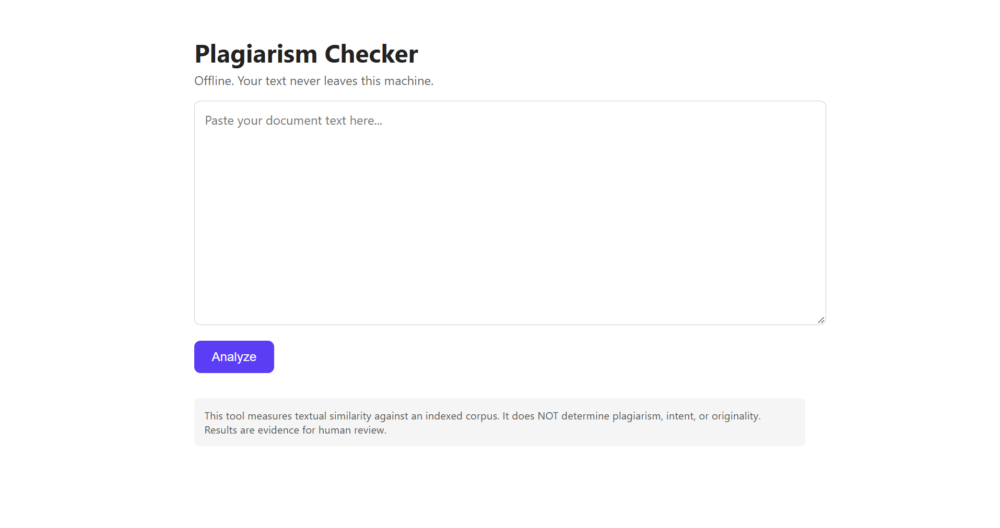
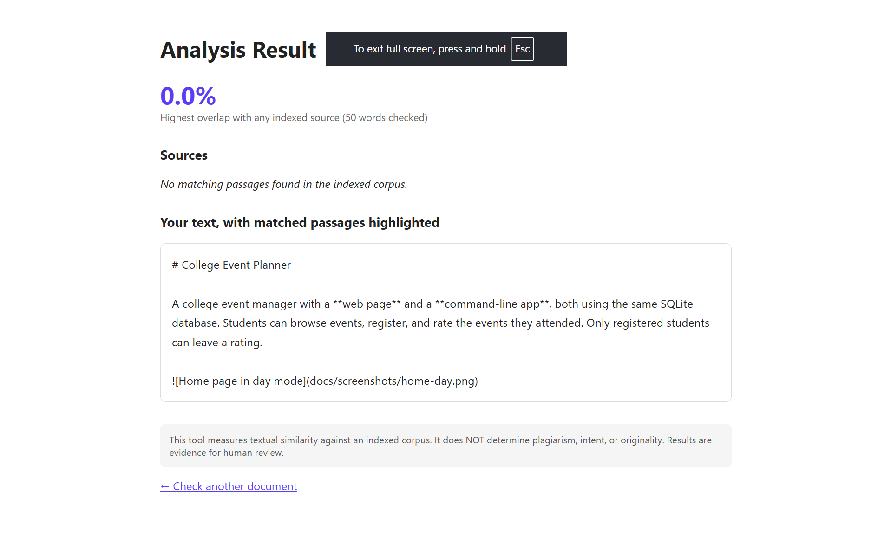

# Plagiarism Checker

An offline plagiarism similarity tool with a **Flask web page** and a **command-line interface**, both using the same local SQLite database. Documents are fingerprinted using 5-word k-grams and the winnowing algorithm.

> **Disclaimer:** This tool measures *textual similarity* against an indexed corpus. It does NOT determine plagiarism, intent, or originality. Results are evidence for human review.

## Features

- **Offline & Private:** No internet required at runtime. Documents stay on your laptop.
- **Fingerprinting:** Converts documents into 5-word fingerprints using reproducible `blake2b` hashing.
- **Winnowing:** Keeps a sparse set of fingerprints (k=5, window w=4) to guarantee matching passages are found without storing every single word.
- **Database:** SQLite schema with idempotent indexing and cascade deletes.
- **Alignment & Scoring:** Reconstructs matched fingerprints into contiguous passages and calculates a **coverage percentage**.
- **Web UI:** Paste text into the browser to see matched passages highlighted in different colors.
- **CLI:** `index`, `status`, and `query` commands for terminal workflows.

## Screenshots

### Home page (Upload)


A clean interface to paste text and analyze it against the local corpus.

### Result page (Analysis)


The result page highlights exact matched phrases in yellow (or blue, depending on the source) and shows the coverage percentage per source.

## Setup

```bash
python -m venv .venv
# Windows:
.\.venv\Scripts\Activate.ps1
# Linux/macOS:
# source .venv/bin/activate

pip install -r requirements.txt
pip install -e .